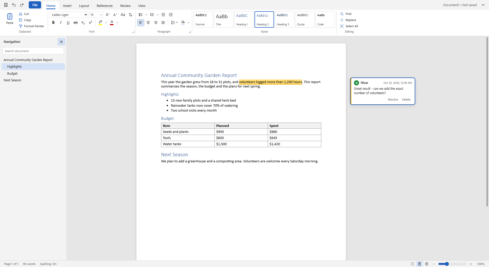
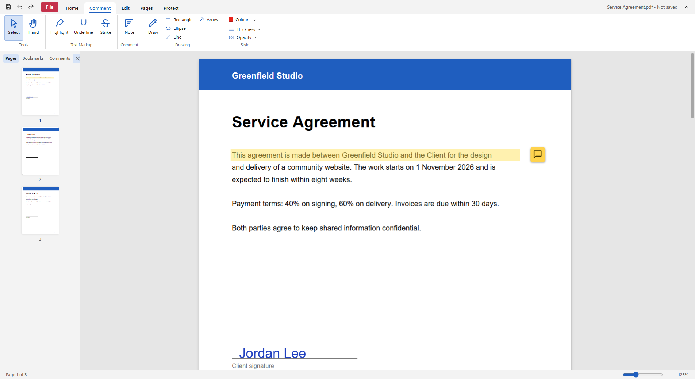

# Nisar Office Studio

A free, open-source word processor and PDF editor for Windows. It works offline: no account, no ads, no tracking.



## Features

**Documents:** styles and headings, lists, tables, pictures, links, headers and footers, page numbers, page setup and columns, comments, track changes, table of contents, footnotes, navigation pane, watermarks, find and replace, spelling check, dark mode. Opens and saves `.docx`, `.html` and `.txt`; exports to PDF.

**PDFs:** view, search, bookmarks; highlight, underline, strike, sticky notes, drawings and stamps; add and edit text and pictures; fill and create form fields; signatures; insert, delete, rotate, reorder, crop, extract, split and combine pages; pictures to PDF; headers, footers, Bates numbers and watermarks; redaction; AES-256 passwords; text recognition (OCR) for scans; reduce file size; remove hidden information; convert to an editable document.



## Install

- **Microsoft Store:** search for "Nisar Office Studio" (once published).
- **Installer:** download `NisarOfficeStudio-Setup-<version>.exe` from the [Releases](https://github.com/nisarkhan4u-hash/nisar-office-studio/releases) page. The installer is not code-signed, so Windows SmartScreen may warn you and Smart App Control may block it; the Microsoft Store version is signed by Microsoft and does not have this problem.

## Build from source

Requirements: Windows 10 or 11, [Node.js](https://nodejs.org) 24.

```
npm ci
npm start            # run the app
npm run smoke        # document editor tests
npm run pdf-smoke    # PDF editor tests
npm run dist         # installer  -> dist\NisarOfficeStudio-Setup-<version>.exe
npm run dist:store   # Microsoft Store package -> dist\NisarOfficeStudio-<version>.appx
```

Publishing to the Microsoft Store for free is explained step by step in [docs/DISTRIBUTION.md](docs/DISTRIBUTION.md).

## Privacy

The app collects no data. See the [privacy policy](docs/privacy-policy.html).

## Licence

MIT, see [LICENSE](LICENSE). Third-party components and their licences are listed in [THIRD-PARTY-NOTICES.md](THIRD-PARTY-NOTICES.md). PDF passwords use [qpdf](https://qpdf.sourceforge.io) (Apache 2.0), OCR uses [tesseract.js](https://github.com/naptha/tesseract.js) (Apache 2.0), and PDF rendering uses [PDF.js](https://mozilla.github.io/pdf.js/) (Apache 2.0).

Nisar Office Studio is an independent project. It is not affiliated with or endorsed by Microsoft or Adobe.
